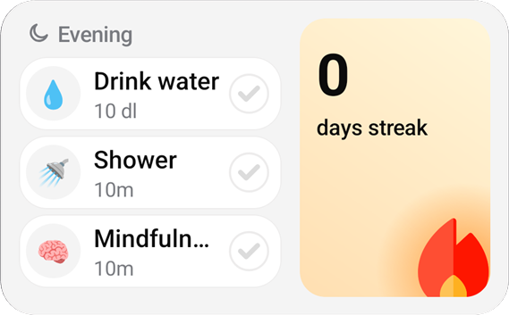
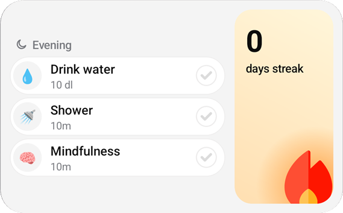
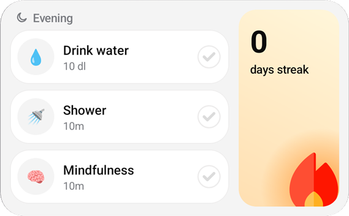

# Android home screen widgets: report

Branch `claude/sweet-goldberg-f7ropv`. All four widgets (Streak, Streak week,
Today ring, Up next) are built with Jetpack Glance and tested on an API 35
emulator. Every check in section 3 ran; findings and fixes are below.
Screenshots are in [`shots/`](shots/) as 40 % JPEGs (raw PNGs were 64 MB).

## Toolchain

| | |
|---|---|
| Flutter | 3.44.0 stable (Dart 3.12.0), Windows 11 |
| JDK | 21.0.13 |
| Android | AGP 8.11.1, Gradle 8.14.3, Kotlin 2.3.0 (+ Compose compiler plugin 2.3.0), compileSdk/targetSdk 36, minSdk 26 (unchanged) |
| SDK | build-tools 35.0.0 / 36.0.0, platforms 33–37, cmdline-tools (Android CLI 1.1) |
| Libraries | `androidx.glance:glance-appwidget` 1.2.0, `home_widget` 0.10.0 |
| Emulator | 37.3.10; new AVD `Habitt_API35`: Pixel 7 profile (1080×2400, 420 dpi), `system-images;android-35;google_apis;x86_64` r09 (rootable, needed for `adb root` / `date`) |

`flutter pub get` with this Flutter rewrites `pubspec.lock` (older pins of
`clock`, `intl`, …). That churn is not committed.

## Built

Kotlin, `android/app/src/main/kotlin/com/shellz/habitt/widgets/`:

- `WidgetSnapshot.kt`: snapshot model and parser (`v == 1`, ids as `Long`),
  `blockAt(now)` (tomorrow from `nextDayStartsAt` on), `PartOfDay` (04/12/19),
  `WidgetClock.nextUpdate`.
- `HabittWidgets.kt`: the four `GlanceAppWidget`s, a shared base (state from
  home_widget's preferences, `SizeMode.Exact`, "Open Habitt" without a
  snapshot) and the four receivers with the names the Dart side calls.
- `WidgetUi.kt`: day/night colours from the design canvas (the accent comes
  from the snapshot), tap links (`actionStartActivity<MainActivity>(context, uri)`),
  `Canvas` bitmaps for the ring, week arcs and pies, shared composables.
- `WidgetRefresh.kt`: one inexact boundary alarm plus a receiver for clock,
  time zone and locale changes, boot and app updates.
- `MainActivity.kt` (existing): keeps a widget launch intent so a tap that
  revives a dead process reaches `WidgetLaunchHandler` (see Bugs).

Resources:

- `res/drawable` and `res/drawable-night`: per-mood backgrounds
  (`widget_bg_streak_*`, `widget_bg_tile_*`, `widget_bg_week_*`, `widget_bg_plain`,
  `widget_bg_upnext`): gradient, radial glow and artwork in one layer-list.
  Also white masks (`widget_circle`, `widget_check`, `widget_ring_*`, `widget_sun/moon/anytime`, row shapes).
- `widget_art_*`: VectorDrawables generated from `streak.svg`, `streak-fade.svg`,
  `ice-left.svg`, `ice-over.svg` by `tool/svg_to_vector_drawable.dart`.
- `res/xml/widget_*_info.xml`: provider info (2×2, Up next 4×2 horizontally
  resizable, `targetCell*`, localized `description`, no polling).
- `res/drawable-nodpi/widget_preview_*.png`: picker previews cropped from the
  real widgets.
- `res/values[-bs,-de,-es,-fr,-it,-pt,-tr]/widget_strings.xml`: generated from the ARB files by
  `tool/gen_android_widget_strings.dart`.
- `AndroidManifest.xml`: 4 widget receivers, `WidgetRefreshReceiver`, the
  `es.antonborri.home_widget.action.LAUNCH` intent filter on `MainActivity`.
- `build.gradle.kts` / `settings.gradle.kts`: Glance, Compose plugin, JUnit, org.json for tests.

Dart:

- `lib/services/widget_snapshot_builder.dart`: snapshot `strings` gain `day` / `days`
  (Streak week's short label), and today's streak health follows the count
  shown (see Bugs).
- ARB: new `widgetOpenApp` in all 8 languages (`lib/l10n/*` regenerated).
- Tests: `test/services/widget_snapshot_builder_test.dart` (+2 cases).

Docs: `docs/home_widgets.md` now describes the Android side, the boundary
alarm, tap handling after process death and the generators.

## Tests

| | Command | Result |
|---|---|---|
| Dart analyzer | `flutter analyze` | 0 errors; 149 infos/warnings, the same count as the baseline before any change (exit code 1 comes from those) |
| Dart tests | `flutter test` | 757 passed (baseline 756 + 1 new) |
| Kotlin JVM tests | `cd android && ./gradlew :app:testDebugUnitTest --tests "com.shellz.habitt.widgets.*"` | 13 / 13 passed |
| Build | `flutter build apk --debug` | OK |

Kotlin tests (`android/app/src/test/kotlin/com/shellz/habitt/widgets/WidgetSnapshotTest.kt`):
full parse, invalid/empty/other-version snapshots, old snapshots without
`day`/`days`, bad accent, 16-digit habit ids, ring tap target, today vs.
tomorrow before/after `nextDayStartsAt`, parts of day at 03:59 / 04:00 / 11:59 /
12:00 / 18:59 / 19:00 / 00:00, Up next section by clock, perfect day, next
refresh time (incl. a non-midnight day start).

## Checklist (section 3)

| # | Check | Result | Shots |
|---|---|---|---|
| 1 | analyze, test, Kotlin tests | **Passed** | – |
| 2 | Build, install, onboarding, 6 habits (amount, duration, checkbox, Morning / Any time / Evening, 1 optional) | **Passed** | `04_*` |
| 3 | All 4 widgets added through the launcher picker (real drag and drop, no debug pin call) | **Passed** | `02_picker_previews` |
| 3 | Light and dark | **Passed**: dark switches live, no redraw needed | `07_*`, `08_*` |
| 4 | Complete a habit | **Passed**: within ~3 s | `05_complete_one_upnext` |
| 4 | Partly log one | **Passed**: pie, `6m / 10m`, ring segment, week arc | `06_*` |
| 4 | Complete everything | **Passed**: Day complete, accent check in ring, streak 0→1 with badge, week flame (after the fix in Bugs 2) | `07_*` |
| 4 | Theme Violet | **Passed**: ring, checks, done rows violet | `09_*` |
| 4 | Language Bosnian | **Passed**: "dan streak", "Dan završen …", weekday letters | `10_*` |
| 5 | Taps, app killed | **Passed** (after Bugs 3): Up next row → that habit, ring → first not-done habit, Streak / Streak week → home. Tested after real process death (`kill -9`) and after `force-stop` (see note) | `11_*` |
| 5 | Taps, app in background | **Passed**: same targets | – |
| 5 | Log progress | **Passed**: a tracked habit's row opens Log duration (checkbox habits open details, as `openHabit` intends) | `11_tap_row_procdeath_log_progress` |
| 6 | Day boundary, app not running | **Passed**: 23:58 → the alarm fired at 00:05 (inside its window) and rolled all widgets to the next day; 11:58 → 12:10 Morning → Any time; clock jump to 19:01 → Evening at once. Auto time restored | `12_*` |
| 7 | No habits today | **Passed**: "Nothing scheduled today", dormant streak | `03_*` |
| 7 | More than 8 habits | **Passed**: 9 segments, no emojis; 8 still shows emojis | `13_edge_ring_9_habits`, `14_preview_state_ring_8_habits` |
| 7 | Fresh install before the first snapshot | **Passed**: "Open Habitt to see your habits here", tap opens the app | `13_edge_fresh_install` |
| 7 | Up next wider | **Passed**: rows stretch, tile stays 104 dp. Tested with `wm density 300` (the widget already spans the 4-column grid) | `13_edge_upnext_wide` |

Notes on the tap tests:

- `adb shell am force-stop` cancels all of an app's PendingIntents, widget
  taps included (platform behaviour). Afterwards the first tap only wakes the
  app (Glance redraws with new intents), the second one opens it. Normal process
  death keeps them, and those taps work first time.
- On the first open of a new day the app's own streak celebration sheet
  appears over the Log progress sheet a widget tap opened (shot
  `11_tap_row_procdeath_log_progress`). Not widget code; see Open questions.

## Bugs found and fixed

1. **Habit ids overflowed `Int`** (Kotlin). Ids are microsecond timestamps
   (`1795574050137094`), so the tap links carried wrong ids. Ids are `Long`;
   test added. (`2ef8c732`)
2. **First perfect day showed the start-a-streak invite** (Dart). Today's
   health was resolved from the streak without today, so a first perfect day
   was "dormant": "1 day" plus "Complete every habit today to start a
   streak", and the Streak card hid its count. Health now follows the count the
   widget shows; test added. Dormant also uses the healthy look on Android,
   as the home page card does. (`97d7c0fa`)
3. **Widget taps after process death opened the home page** (Kotlin,
   `MainActivity`). The task survives the process, so the tap recreates the
   activity with the task's old intent and delivers the new one via
   `onNewIntent` before Dart listens, and home_widget drops it.
   `onNewIntent` now keeps a widget launch as the activity's intent (so
   `initiallyLaunchedFromHomeWidget()` reports it), and `onCreate` neutralises a
   restored widget-launch intent so reopening the app later does not replay an
   old tap (checked from the launcher icon and from recents). (`d8209b7d`)
4. **Checkbox rows in Up next** had the name off-centre (empty progress text). (`2ef8c732`)

## Deviations

- **Day boundary scheduling** is native (`WidgetRefresh`: `AlarmManager.setWindow`,
  `RTC`, 10-minute window, next of 00/04/12/19 h and `nextDayStartsAt`,
  re-armed after every redraw), not `HomeWidget.scheduleWidgetUpdates`. The
  plugin would use exact alarms here, because the app already holds
  `SCHEDULE_EXACT_ALARM` for habit alarms. Updates can therefore arrive up to
  ~10 minutes after a boundary (seen: 00:05, 12:10).
- **Drawing**: not everything is drawn into bitmaps. Backgrounds and artwork are
  resource drawables with `-night` variants, and shapes are white masks tinted
  with day/night colours. So light/dark follows the system on Android 12+
  without the app or a redraw. Only the ring segments, week arcs and pies are
  `Canvas` bitmaps (masks, tinted the same way).
- **Corner clipping**: Glance's `cornerRadius` clips only on Android 12+. On
  8–11 the backgrounds still have rounded corners, but the radial glow can show
  at the corners.
- **Previews** use `previewImage` (PNG crops of the real widgets) rather than a
  `previewLayout`.
- **Glance version** is 1.2.0, the version home_widget 0.10.0 already brings in.
- **Snapshot**: added `strings.day` / `strings.days` (additive, `v` stays 1).
- **New string** `widgetOpenApp` for the state before the first snapshot.
- **Streak week text**: the line can wrap to 2 lines and the empty space grows
  with the launcher cell height (this launcher's 2×2 is about 180×235 dp, taller
  than the 170×170 design).

## Open questions

1. "days **S**treak": the label is `loc.days + ' ' + loc.streak`, and English
   `streak` is capitalised. The widget copies the home page card, which shows
   the same. Should both say "days streak"? A dedicated ARB phrase would also
   suit languages with other word order.
2. The home page streak card **hides itself while dormant**, including on a
   first perfect day (streak 1). The widget now shows "1 day". Should the app
   card do the same?
3. The streak celebration sheet opens on top of Log progress when a widget tap
   is the first open of the day. Should a widget launch skip or delay it?
4. Dark healthy ember (`#FFE07A→#F47200`) with white text has low contrast at
   the top of the card. That matches the design canvas; worth a look.
5. After **Clear data** in system settings, widgets keep the last snapshot
   until the app is opened again (the app gets no broadcast). Acceptable?
6. Up next on very tall cells leaves empty space under 3 rows. Center the
   block, or allow more rows (would need more ids in the snapshot)?

## Other findings (not changed)

- Onboarding language chips: "RIGHT OVERFLOWED BY 19 PIXELS" on
  "Português (Brasil)" (`shots/01_onboarding_overflow_preexisting.jpg`).
- In the Habits flow, tapping the "Optional habit" label does not toggle its
  checkbox; only the box does.

## Notes for iOS

- Habit ids are 16-digit: decode as `Int64` (`Int` on 64-bit Swift is fine;
  never `Int32`).
- Today's streak health now follows the shown count (Bugs 2); dormant should
  use the healthy look, as on Android and the home page card.
- `strings.day` / `strings.days` exist for a short "days" label.
- Up next rows without `progressText` should centre the name.
- Use the four `widget_art_*` sources (`assets/images/new-svg/…`) as PDF/SVG
  assets; the critical composition offsets are in the drawables
  (`widget_bg_streak_critical.xml`, `widget_bg_tile_critical.xml`).
- Taps need `homeWidget` in the URL query (already in the docs).

## Follow-up round (2026-11-25)

Changes after review of the open questions, tested on the same emulator.

| Item | Result | Shots |
|---|---|---|
| Lower-case "days streak" (Q1) in the app card and all widgets, via new `dayStreakLabel` / `daysStreakLabel` ARB keys in all 8 languages | **Passed** | `17_*` |
| First perfect day (Q2): the home page card shows "1 day streak" instead of hiding (`StatsProvider.shownPerfectDaysStreak`), widgets match | **Passed** | `17_first_perfect_day_app_card`, `17_first_perfect_day_widgets` |
| Streak celebration after a widget tap (Q3): waits until Log progress closes. App killed, clock moved to the next day, Up next row tapped: Log progress first, celebration after Cancel | **Passed** | `19_widget_tap_log_progress_first`, `19_celebration_after_log_closed` |
| No habits at all: Today ring and Up next show the empty box art and "You haven't added any habits yet" (snapshot `hasHabits` / `strings.noHabits`) | **Passed** | `16_*` |
| Fresh install, before the first snapshot: no habits and a 0 streak instead of "Open Habitt" (native placeholder in the device language) | **Passed** | `15_fresh_install_*` |
| Dormant Streak card shows 0, "days streak" and the invite line | **Passed** | `15_fresh_install_streaks` |
| 9+ habits: Today ring is one plain ring filled to the day's progress | **Passed** (4/9) | `20_ring_9_habits_continuous` |
| Onboarding "Português (Brasil)" chip overflow: the name now shrinks to fit | **Passed** | `15_onboarding_chip_fixed` |

Up next layouts for Android's taller cells (Q6). **C Stretched was chosen**;
the switch and the other two were removed:

| A Scaled (iOS design × up to 1.3) | B Centred (iOS sizes) | C Stretched (rows grow) |
|---|---|---|
|  |  |  |

Scaled fills the cell but truncates longer names ("Mindfuln…") and makes the
tile wider; Centred keeps iOS proportions and leaves bands above and below;
Stretched keeps the text sizes and spreads the rows.

Note: killing the process one second after a time change interrupted one
widget's redraw (it caught up on the next update). That was the test, not a
bug: a normal boundary update finishes in well under a second.

Tests: `flutter analyze` 0 errors (149 issues, as before), `flutter test`
759 passed, Kotlin `WidgetSnapshotTest` 15/15.

The Streak and Up next picker previews were recaptured with the lower-case
label and the stretched layout. The language chip now ends long names in
"…", as the ClickUp bug asked, instead of shrinking them.
